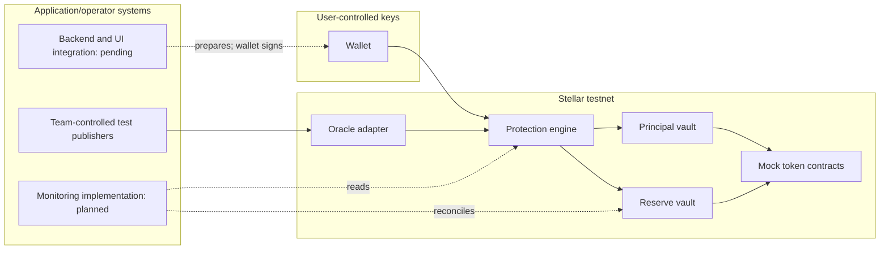

# Internal security review and Audit Bank preparation

9 November 2026. This is AI-assisted internal review of code the assistant also helped author. It is **not an independent audit**, audit-provider engagement or security certification. No reviewer has been booked and no Audit Bank acceptance is claimed.

## Scope and executed checks

- Deployed Rust source: commit 6e85036b236df94c550434efdbf7e9287d417921; protection_engine, reserve_vault, protected_balance_vault and oracle_adapter. The published deployment evidence matches their WASM hashes and successful controlled transactions. No new Rust deployment was performed in this review.
- Focused `cargo clippy` across those four crates/all targets completed with no compiler errors. It emitted 52 warning records, including repeated lib/test diagnostics: deprecated event publishing, argument-count/style and needless-borrow warnings. These are not 52 distinct security vulnerabilities. See artifacts/internal-review-20261109.json.
- Existing contract verification: 52 unit tests and eight deployment-boundary tests. Four additional deterministic reserve-model tests now check conservation, cap/tail loss, rejected undercollateralization and unsupported zero-price input. These do not establish statistical pricing validity.
- Public backend baseline 73f40010c06290d5bc8892cffe7573c5ed5af640 passed 26 tests. Production dependency audit reported seven affected packages: one critical, five high and one moderate, including transitive advisories. This is a package-advisory classification, not proof of seven exploitable application flaws.
- Draft remediation https://github.com/CoverFI-space/CoverFi-backend/pull/1 updates dependency locks and Stellar SDK 17.4.0, adapts byte/hash/decorated-signature handling and declares Node >=22.12.0. All 26 backend tests pass on that branch; its production dependency scan reports zero known advisories. The PR is not merged or deployed. Other RPC/oracle/XDR paths need integration verification before release; passing route tests does not cover every migration surface.
- No RustSec dependency audit, formal Soroban-specific vulnerability scanner, penetration test, independent audit or external-user session is claimed as executed here.

## STRIDE register and open work

| ID | Threat / control reviewed | Evidence and open work |
| --- | --- | --- |
| S.1 Spoofing | Reserve engine/reward methods require authorization, not just a supplied address | Existing negative auth tests and a real engine-to-vault call test; independently review the role policy before real-value use. |
| T.1 Tampering | Market-bound, positive, nonfuture observations; matching quorum; vote epoch isolation | Native tests and controlled testnet feed. All current publisher keys are team-controlled; independent data/operator correctness remains unproven. |
| R.1 Repudiation | Release commit, hashes, events and receipts provide an evidence trail | Published testnet receipts. Named human/CA sign-off and an incident evidence process are still needed. |
| I.1 Information disclosure | Public backend tests cover wallet-path log redaction and signed-session access | Backend dependency migration is a draft; production retention, secrets and access configuration were not inspected. |
| D.1 Denial of service | Missing expiry observations retain collateral; old expiry data is not limited to the quote ring | Missing data can leave positions locked indefinitely; no timeout exit exists. Recovery policy, archival handling and operational coverage require independent assessment. |
| D.2 Denial of service | Deviation checks reject outliers, including large positive recovery moves | A recovery greater than 100% relative to a deeply depegged observation can halt acceptance. Model/test the operating policy before launch. |
| E.1 Elevation of privilege | Admin/publisher changes require authorization | Admin can reassign the reserve's trusted engine without a timelock or enforced safe migration. Never repoint an old funded reserve; governance/migration controls remain launch blockers. |

## Readiness package and handoff

Provide the architecture/STRIDE register, exact source scope, tests, dependency scan/PR, immutable deployment reports, model assumptions, explicit open issues and a private monitoring/response plan. Freeze the requested audit scope and resolve known blockers with a qualified reviewer. Do not call internal author review independent.

The supplied SCF application was not awarded. Audit Bank funding/eligibility is therefore not assumed. If SCF confirms eligibility, request its intake process; professional review and any required co-payment/scheduling are separate from this Build budget. Audit-provider fees are not included in the USD 50,000 ask. No request or engagement has been sent by the assistant.

Current source: [Audit Bank rules](https://stellar.gitbook.io/scf-handbook/supporting-programs/audit-bank/official-rules), [readiness checklist](https://stellar.gitbook.io/scf-handbook/supporting-programs/audit-bank/audit-readiness-checklist). Current deployment remains testnet only. Future mainnet launch requires independently resolved security, governance, oracle/asset, reserve and applicable legal gates.
