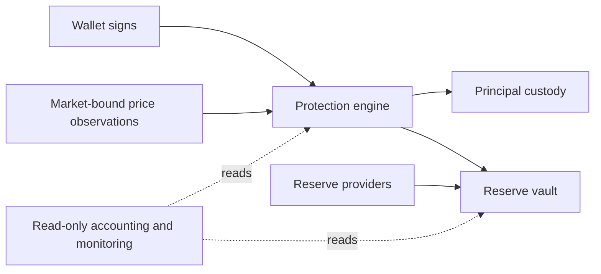

# Focused funding scope - USD 50,000

Updated 9 November 2026. One protected stablecoin market and one protection/reserve primitive. Current deployment is testnet only; a future gated mainnet launch is planned, not completed. Engineering target: twelve weeks from award start, with external review dependencies explicitly managed.

Fund protection_engine and reserve_vault plus necessary protected_balance_vault and oracle_adapter dependencies. Include only the wallet app/backend, pricing-unit implementation, reserve diagnostics, oracle reliability, monitoring and one core partner integration required to use that primitive. Unrelated registries, payment/floor engines, ZK flows, invoice APIs and AI assistants remain excluded.

The four-contract testnet deployment is verified in TESTNET_DEPLOYMENT.md. Mock USDC is not Circle-issued; CFUSD has no monetary value. Current data feed and smoke wallets are team-controlled. The founder will update app/contract integration; it is not counted as completed here.

Future-work phase costs: USD 15,000 connected MVP (USD 5,000 advance plus USD 10,000 completion payment), USD 15,000 usable testnet pilot/monitoring, USD 20,000 gated capped mainnet launch. Existing code and deployment are baseline evidence, not reimbursable work. BUDGET_50000.md reconciles work estimates and payments.

The founder reports a fourth member who is a CA with crypto tokenomics experience. Identity, professional background and availability remain pending. His proposed work is testable reserve accounting and financial diagnostics; insurance underwriting credentials are not invented.

External pilot target: ten independent testers and twenty completed positions after integration. Capital-demand work: three provider interviews and consented conditional letters with actual amounts where obtained. No universal USD 10,000 entry requirement or pre-grant real-capital deposit is asserted. One partner-owned integration remains a future target; Tael's reported acknowledgement is not a completed integration.
