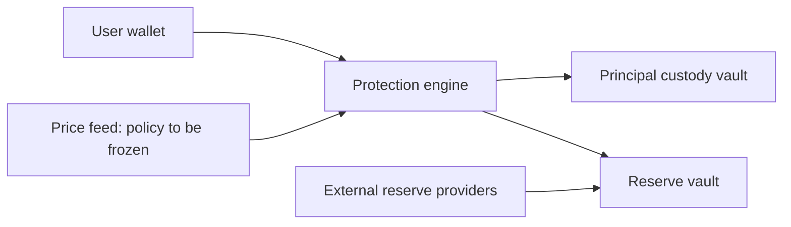

# Focused funding scope

Proposed 12-week, USD 40,000 testnet project. Not an announced mainnet release.

## One primitive and one market

Build and validate a single USDC testnet price-protection market using protection_engine and reserve_vault. Include protected_balance_vault and a price-feed component only as required dependencies. Final asset contract, issuer, payout denomination, premium units and loss-conversion semantics must be specified and tested in milestone 1; same-token depeg payout cannot be advertised as a guaranteed USD make-whole.

The public workspace currently has seven crates. It is legacy implementation input, not a completed minimal release. protection_engine currently references zk_verifier for high-value gating and oracle_adapter for prices. Removing proof gating from the funded release is planned work; optional dependencies are not magically removed by this scope document.

Excluded from the ask: username_registry, receipt_registry, payment_lock_engine, floor_shield_engine, zk_verifier, partner invoice API and AI assistant. Local-only or historical implementations are not claimed as public grant deliverables. A partner integration uses only the core protection lifecycle.

This diagram is the proposed funded release. It is not an attestation of a current deployment.

## Outcomes

- Weeks 1-3, USD 12,000: reproducible minimal release, denomination/settlement specification and reconciled testnet lifecycle.
- Weeks 4-7, USD 16,000: target 10 third-party testers, 20 positions opened and settled, and two named conditional LP commitments totaling USD 10,000. No current commitments are claimed.
- Weeks 8-12, USD 12,000: target one partner-owned live testnet integration, independent scoped technical review and a published go/no-go report.

Targets are prospective; publish transaction evidence, named permitted commitments, actual metrics and shortfalls. See SCF_APPLICATION_REVISED.md for acceptance criteria and BUSINESS_PLAN.md for the model. The current team's underwriting experience gap remains explicit; no additional specialist member is claimed.
